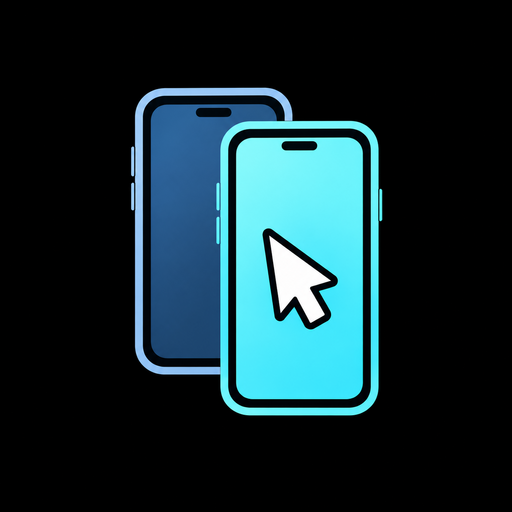
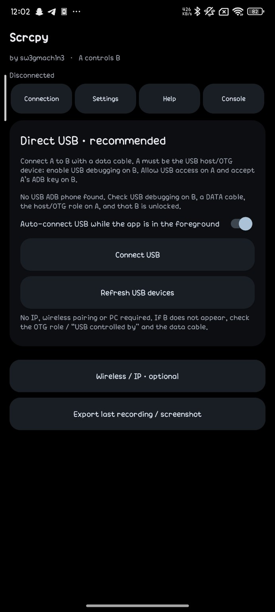
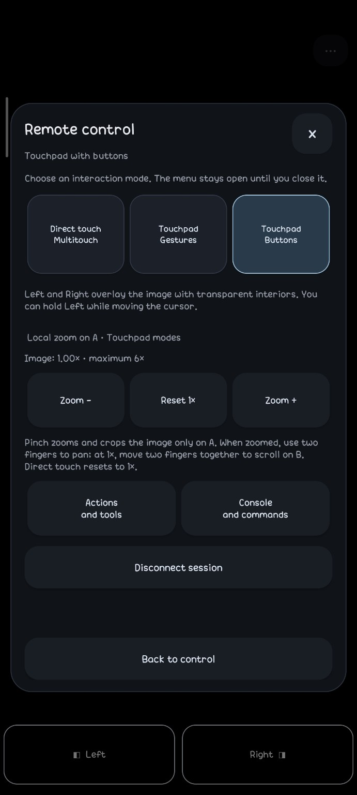
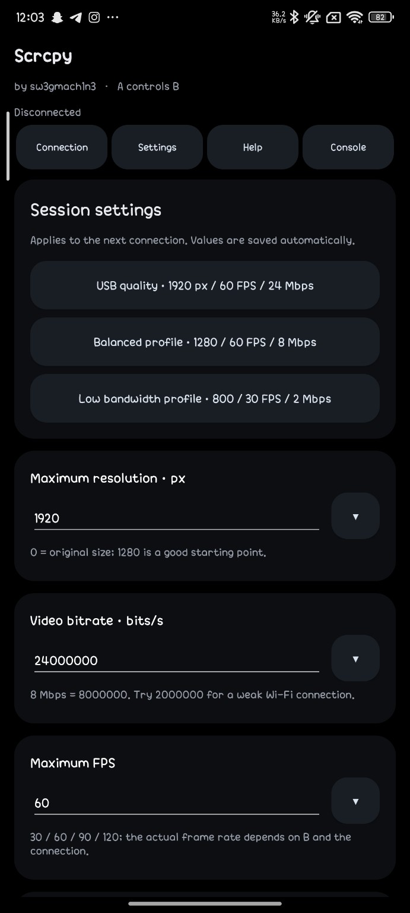
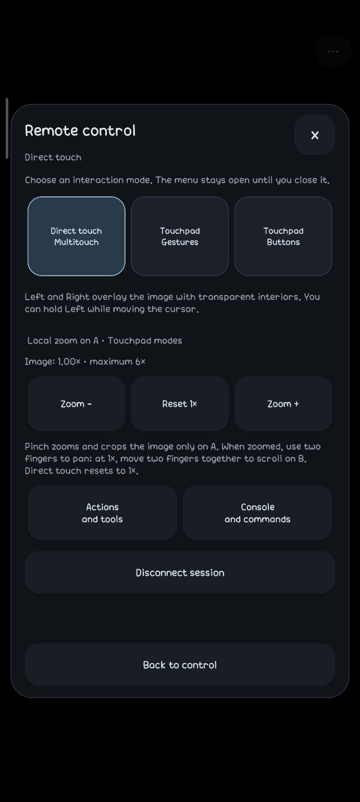
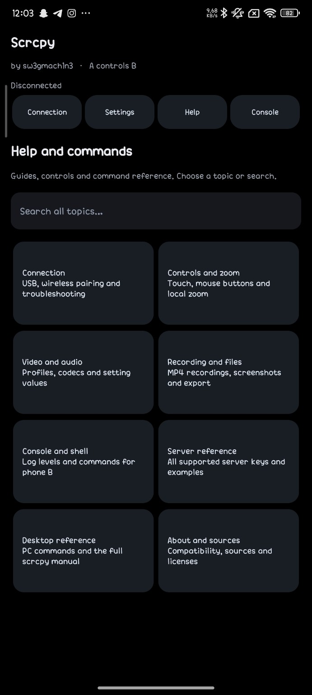
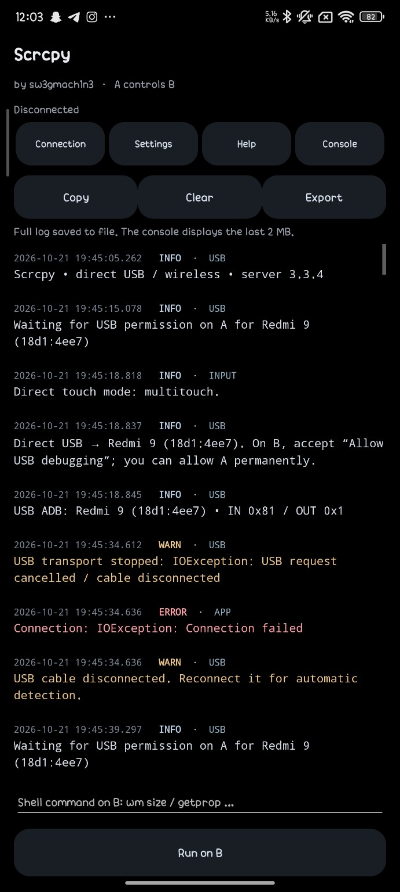

## **[DOWNLOAD](https://github.com/sw3gmach1n3/Scrcpy_for_Android/releases/tag/V1)**
# Scrcpy for Android

View and control one Android phone from another. Connect them with a USB data cable, open the app, and use the second phone through direct touch or a mouse-style touchpad. Wireless ADB is available too.

A black interface, adjustable streaming quality, transparent mouse buttons, and the tools you need while connected — all in one Android app.

<p align="center">
  
</p>

<p align="center">
  
  
</p>

## Features

- Android-to-Android screen mirroring and remote control
- Direct USB connection through USB host/OTG — no PC or wireless pairing needed
- Optional network ADB and wireless pairing
- Direct touch with multitouch support
- Gesture touchpad and a separate touchpad mode with Left/Right mouse buttons
- Transparent mouse buttons over the video, with held-button dragging
- Local pinch zoom from **1× to 6×** and two-finger panning — enlarge the mirrored image without zooming the content on the other phone
- Two-finger scrolling on the remote phone when viewing at 1×
- Ready-made quality profiles, dropdown presets, and manual settings for resolution, FPS, bit rate, codecs, and more
- Fullscreen control menu with large buttons that stays open until you close it
- Android navigation, volume, screen power, notification panel, and quick settings controls
- Clipboard transfer in both directions
- PNG screenshots and H.264/AAC MP4 recording
- Built-in Help with categories, search, explanations, and copyable command examples
- Colored console with timestamps, log levels, source labels, Copy, Clear, and Export
- Shell commands on the connected phone
- English and Romanian interfaces, selectable in Settings
- Optional automatic USB connection while the app is in the foreground
- Existing sessions stay connected when you switch to another app

## Usage

Install the APK on the phone you want to use as the **controller (A)**. The other phone is the **controlled device (B)**.

1. Enable **Developer options → USB debugging** on B.
2. Connect the phones with a USB data cable. A needs the **USB host/OTG** role.
3. Open Scrcpy on A and allow USB access when prompted.
4. Accept the **USB debugging authorization** prompt on B.
5. Tap **Connect USB**, or enable automatic connection while the app is open.

The app only needs to be installed on **A**. It starts the bundled scrcpy server on **B** through ADB.

Once connected, choose direct touch or a touchpad mode from the fullscreen menu. Use **Actions and tools** for navigation, clipboard, capture, and other session controls.

## Quality profiles

| Profile | Maximum dimension | FPS limit | Video bit rate |
| --- | ---: | ---: | ---: |
| USB quality | 1920 px | 60 | 24 Mbps |
| Balanced | 1280 px | 60 | 8 Mbps |
| Low bandwidth | 800 px | 30 | 2 Mbps |

All three profiles use H.264. You can also choose individual values from dropdowns or enter your own. The maximum dimension limits the longer side of the video; the actual output depends on the connected device. Changes apply to the next connection.

## Screenshots

| Connection | Settings |
| --- | --- |
|  |  |
| **Mouse controls** | **Direct touch** |
|  |  |
| **Help** | **Console** |
|  |  |

## Requirements

- **Controller phone:** Android 8.0 or later, with USB host/OTG support for a direct USB connection
- **Controlled phone:** USB debugging enabled and ADB authorization accepted
- A USB **data** cable and an OTG adapter if needed
- Video, audio, and codec support depend on the devices and Android versions involved

For wireless setup, open **Help → Connection** in the app.

## Notes

- Connecting a USB cable does **not** launch the app. New automatic connections and retries only start while it is in the foreground. An already active session is kept when you switch apps.
- Pinch zoom affects the mirrored view on A. Switching back to direct touch resets it to 1×.
- Recordings use H.264 video and AAC audio. A video configuration change, such as rotation, finalizes the current recording.
- This is an independent Android client using the official **scrcpy 3.3.4** server. Some desktop-only scrcpy features are outside its scope. The desktop reference in Help documents the PC client.

## Build from source

Open the project in Android Studio, install **SDK Platform 35**, and select **JDK 17 or 21** as the Gradle JVM. The project uses Gradle 8.9 and Android Gradle Plugin 8.7.3.

On Windows, run from the project folder:

```powershell
.\gradlew.bat assembleDebug -Pandroid.injected.testOnly=false
```

APK output: `app/build/outputs/apk/debug/app-debug.apk`

## Credits
Made by **[sw3gmach1n3](https://github.com/sw3gmach1n3)**.

Built with [scrcpy](https://github.com/Genymobile/scrcpy/tree/v3.3.4), [libadb-android](https://github.com/MuntashirAkon/libadb-android), and [Conscrypt](https://github.com/google/conscrypt).

See [third-party notices](app/src/main/assets/THIRD-PARTY-NOTICES.txt) for bundled component and license information.
